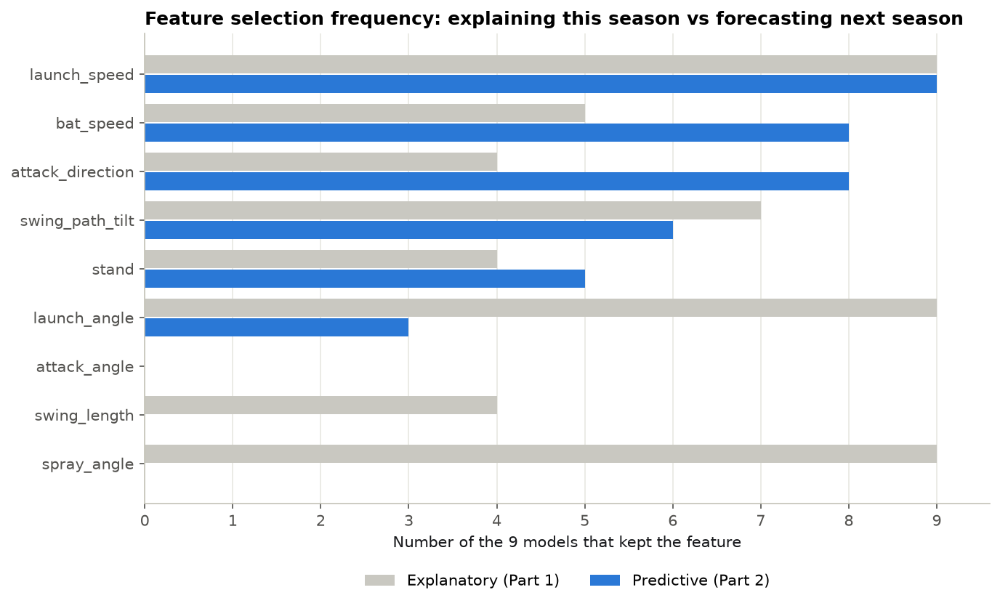
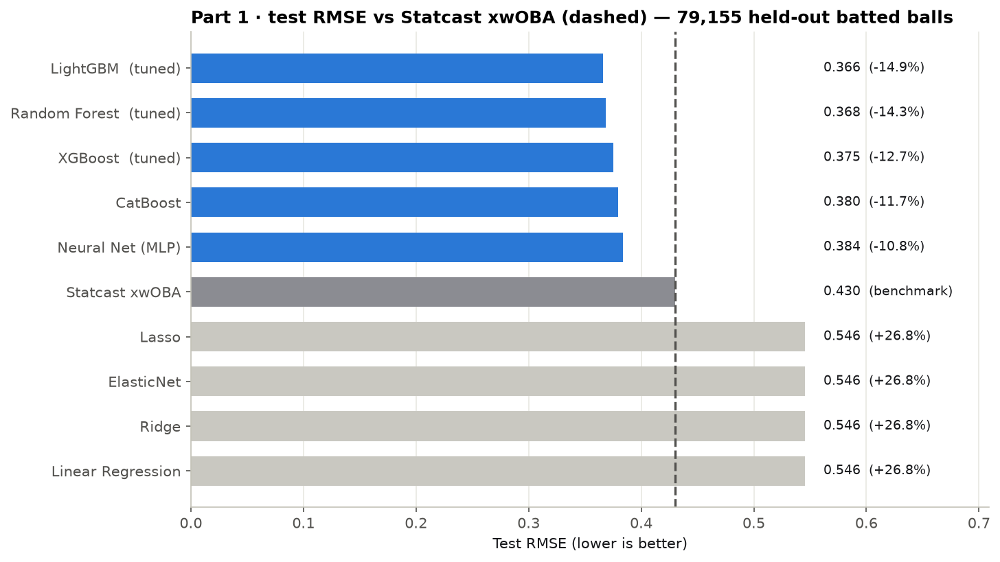
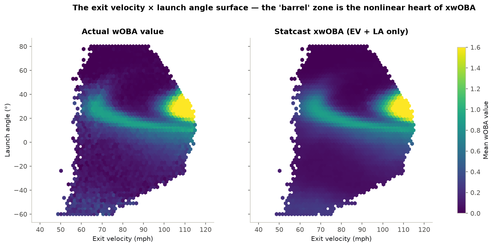
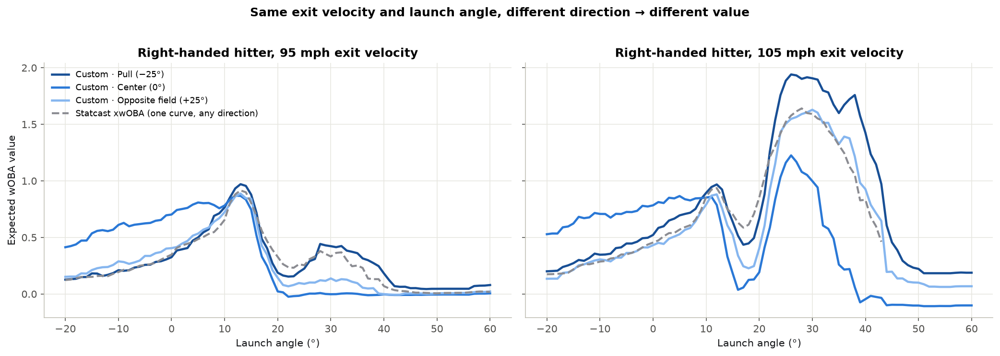
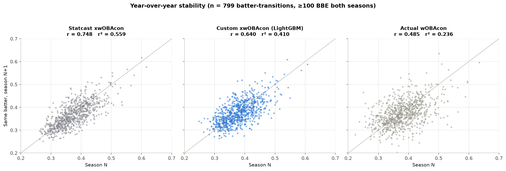
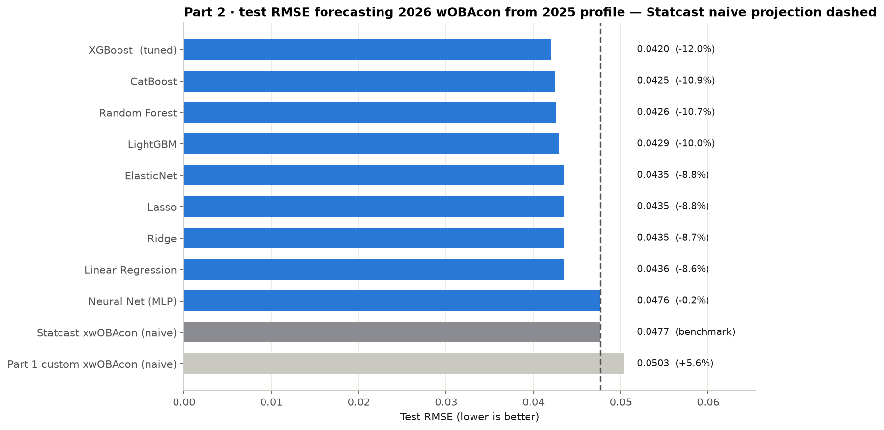
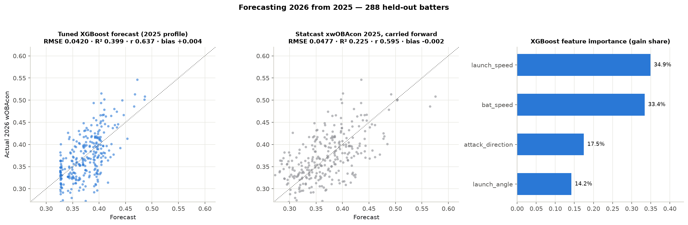

# Beating xwOBA with Bat-Tracking Data

Can Statcast's **bat-tracking** metrics (bat speed, swing length, attack angle, attack direction, swing path tilt) build a better expected-wOBA model than Statcast's own xwOBA?

This project asks that question in two different ways, and gets two different answers.

| | **Part 1: Explanatory** | **Part 2: Predictive** |
|---|---|---|
| Question | Given how a ball was hit, what was it worth? | Given a hitter's season, what will he do *next* season? |
| Unit | One batted ball (395,774) | One batter-season transition (799) |
| Target | Actual `woba_value` of that batted ball | Actual wOBAcon in season N+1 |
| Benchmark | Statcast `estimated_woba_using_speedangle` | Statcast xwOBAcon in season N, carried forward |
| Best model | **Tuned LightGBM: −14.9% RMSE** | **Tuned XGBoost: −12.0% RMSE** |

**📓 Full walkthrough with every chart: [`notebooks/xwoba_modeling.ipynb`](notebooks/xwoba_modeling.ipynb)**

---

## Key findings

1. **Explaining a batted ball:** a tuned LightGBM using exit velocity, launch angle, spray angle, handedness, and swing path tilt beats Statcast's xwOBA by **14.9% RMSE** (R² **0.591** vs 0.436) on 79,155 held-out batted balls. A large part of the gain comes from **direction**, which Statcast's EV + LA model ignores: a pulled fly ball is worth far more than the same ball hit to the opposite field.
2. **Better fit is not a better skill measure.** Statcast's simpler xwOBAcon is more stable year over year (r = **0.748**) than the custom model's (r = **0.640**). Some of what the extra features capture is season-specific noise.
3. **Forecasting a hitter:** a model trained to predict next season directly beats Statcast's carried-forward xwOBAcon by **12.0% RMSE** (R² **0.399** vs 0.225) on a held-out, later season (2025→2026).
4. **The feature story flips.** Ball-flight details (`spray_angle`, `launch_angle`) dominate explanation but barely matter for forecasting. Swing mechanics (`bat_speed`, `attack_direction`) barely matter for explanation but dominate forecasting.
5. **Never useful:** no top model in either framing kept `attack_angle` or `swing_length`.



---

## Method

**9 model families**: Linear Regression, Lasso, Ridge, ElasticNet, XGBoost, LightGBM, CatBoost, Random Forest, and an MLP neural net. Each was run through **forward and backward stepwise feature selection** over 9 candidate features:

`launch_speed` · `launch_angle` · `spray_angle`* · `bat_speed` · `stand` · `swing_length` · `attack_angle` · `attack_direction` · `swing_path_tilt`

\* derived from hit coordinates: `0.75 · atan((hc_x − 125.42) / (198.27 − hc_y)) · 180/π`

For each model, whichever direction (forward or backward) reached the lower cross-validated RMSE defined its feature set. The best models were then hyperparameter-tuned with `RandomizedSearchCV`.

### Part 1: Explanatory (one row per batted ball)
- Scope: wOBA-eligible balls in play (`type == "X"`, `woba_denom == 1`), matching how Statcast scopes xwOBA.
- Random 80/20 split: 316,619 train / 79,155 test.
- Stepwise search on a 50,000-row training subsample with 3-fold CV. Final models refit on the full training set.
- Tuned: LightGBM and XGBoost (60 configs × 5-fold), Random Forest (40 configs × 5-fold).

### Part 2: Predictive (one row per batter-season transition)
- Features: a batter's **season-N mean** of each candidate. Target: his **actual wOBAcon in season N+1**. Both seasons require ≥100 batted balls.
- **Temporal split**: train on 2023→24 + 2024→25 (511 rows), test on 2025→26 (288 rows).
- Stepwise search with 5-fold CV, using shallow, regularized hyperparameters suited to ~500 rows.
- Tuned: XGBoost (3,000 configs × 10-fold).

---

## Results

### Part 1: Explanatory (79,155 held-out batted balls)

| Model | Version | Test RMSE | R² | vs Statcast |
|---|---|---:|---:|---:|
| **LightGBM** | tuned | **0.3661** | **0.591** | **−14.9%** |
| Random Forest | tuned | 0.3684 | 0.586 | −14.3% |
| XGBoost | tuned | 0.3755 | 0.570 | −12.7% |
| CatBoost | stepwise | 0.3796 | 0.561 | −11.7% |
| Neural Net (MLP) | stepwise | 0.3836 | 0.551 | −10.8% |
| *Statcast xwOBA* | *benchmark* | *0.4301* | *0.436* | — |
| Linear / Ridge / Lasso / ElasticNet | stepwise | 0.5456 | 0.093 | +26.8% |



Linear models lose to Statcast because wOBA is a sharply nonlinear function of contact quality. A 100 mph ball at 30° is usually a home run; at 60° it's a pop-up. Regularization can't fix that.



What the custom model sees that Statcast's EV + LA model can't is direction:



### Stability check: does Part 1 hold up next year?

| Metric (season N vs same metric, season N+1) | Pooled r (n = 799) |
|---|---:|
| Statcast xwOBAcon | **0.748** |
| Custom xwOBAcon (tuned LightGBM) | 0.640 |
| Actual wOBAcon | 0.485 |



### Part 2: Predictive (288 held-out batters, forecasting 2026 from 2025)

| Model | Version | Test RMSE | R² | r | vs Statcast |
|---|---|---:|---:|---:|---:|
| **XGBoost** | tuned | **0.0420** | **0.399** | **0.637** | **−12.0%** |
| CatBoost | stepwise | 0.0425 | 0.385 | 0.625 | −10.9% |
| Random Forest | stepwise | 0.0426 | 0.382 | 0.624 | −10.7% |
| LightGBM | stepwise | 0.0429 | 0.372 | 0.617 | −10.0% |
| Lasso / ElasticNet / Ridge / Linear | stepwise | 0.0435–0.0436 | 0.353–0.355 | 0.602 | −8.6 to −8.8% |
| Neural Net (MLP) | stepwise | 0.0476 | 0.228 | 0.512 | −0.2% (tie) |
| *Statcast xwOBAcon, carried forward* | *benchmark* | *0.0477* | *0.225* | *0.595* | — |
| Part 1 custom xwOBAcon, carried forward | naive | 0.0503 | 0.136 | 0.557 | +5.6% |





> **Why Statcast's R² (0.225) is so much lower than its r² (0.595² = 0.354):** the benchmark is a raw number carried forward, not a fitted model. R² penalizes the fact that Statcast's xwOBAcon spreads hitters out more than their next-season outcomes do. Correlation ignores that. The fitted models are optimized for exactly what R² measures, so their R² and r² stay close.

Tuned XGBoost features: `bat_speed`, `attack_direction`, `launch_speed`, `launch_angle` (season means).
Best params: `n_estimators=578, max_depth=4, learning_rate=0.032, subsample=0.60, colsample_bytree=0.60, min_child_weight=2, gamma=0.016, reg_alpha=0.009, reg_lambda=4.36`.

---

## Repository structure

```
├── notebooks/
│   └── xwoba_modeling.ipynb          # Full walkthrough: both parts, all charts and metrics
├── src/                               # Run every script from the repo root
│   ├── pull_bat_tracking_statcast.R   # 1. Pull Statcast data day-by-day via baseballr
│   ├── explore_data.py                #    (optional) column coverage / missingness check
│   ├── prep_features.py               # 2. Filter to batted balls, derive spray_angle
│   ├── run_pipeline.py                # 3. Part 1: stepwise selection × 9 models
│   ├── tune_boosted_models.py         # 4. Part 1: tune XGBoost + LightGBM
│   ├── tune_random_forest.py          # 5. Part 1: tune Random Forest
│   ├── batter_xwoba_by_season.py      # 6. Per-batter-season xwOBAcon (tuned LightGBM)
│   ├── autocorrelation_analysis.py    # 7. Year-over-year stability check
│   ├── prep_predictive_data.py        # 8. Build season-N → season-N+1 dataset
│   ├── run_predictive_pipeline.py     # 9. Part 2: stepwise selection × 9 models
│   ├── tune_predictive_xgboost.py     # 10. Part 2: tune XGBoost
│   └── predictive_xwoba_by_season.py  # 11. Per-batter-season predictive xwOBAcon
├── data/
│   ├── model_data.parquet             # 395,774 modeling rows (derived)
│   └── predictive_dataset.csv         # 799 batter-season transitions (derived)
├── results/
│   ├── *.json                         # Stepwise paths, model metrics, tuned params
│   ├── batter_xwoba_by_season.csv     # Explanatory xwOBAcon, every batter-season
│   ├── predictive_xwoba_by_season.csv # Predictive xwOBAcon, every batter-season
│   ├── autocorrelation_results.csv
│   └── logs/                          # Full console logs from every run
├── figures/                           # PNGs exported by the notebook
└── reports/xwoba_report.html          # Standalone interactive report (download and open in a browser)
```

### Output files

- **`results/batter_xwoba_by_season.csv`**: `batter, player_name, season, n_bbe, custom_xwobacon, actual_wobacon, statcast_xwobacon, custom_minus_statcast`
- **`results/predictive_xwoba_by_season.csv`**: `batter, player_name, season, n_bbe, predictive_xwobacon, statcast_xwobacon, actual_wobacon`. Here `season` is the *forecast* season, predicted from the prior season's profile, so coverage is 2024–2026. Note: this file comes from a refit on **all** 799 transitions for production use, so its values are in-sample. The held-out evaluation numbers are the ones in the tables above.

---

## Limitations

- **Contact only.** Bat-tracking data exists only on swings, so walks, HBP, and called strikeouts are absent. Everything here is xwOBA*con* (on contact), not full xwOBA.
- **Small predictive sample.** 511 training and 288 test transitions over three season pairs. The same batter can appear in multiple pairs, and 2026 is a partial season.
- **Part 1 uses a random split**, so it measures fit rather than out-of-season generalization. Part 2 addresses that directly with a temporal split.
- **Uneven tuning.** In Part 1, three models were tuned; in Part 2, only XGBoost. Other rankings might move with equal tuning effort.
- Part 2's tuned XGBoost feature set (with `launch_angle` in place of stepwise's pick, `stand`) was specified manually, not chosen by stepwise selection.
